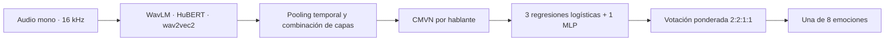

# Emotion Is All You Need

**Reconocimiento de emociones en el habla con representaciones auto-supervisadas y ensembles.**
Proyecto final de **I302 — Aprendizaje Automático y Aprendizaje Profundo**, Universidad
de San Andrés · AI Fest 2026.

**Autores: Bautista García y Tomás González.**

A partir de una grabación de voz, el sistema predice una de ocho emociones:
neutral, calma, felicidad, tristeza, enojo, miedo, disgusto o sorpresa. El trabajo
compara features acústicas expertas con representaciones aprendidas de audio y estudia
cómo separar la emoción de la identidad del hablante.

[Informe completo](informe.pdf) · [Póster](docs/Garcia_Gonzalez_Poster_PF.pdf) ·
[Notebook principal](notebooks/main.ipynb) · [Guía de reproducción](docs/reproduccion.md)


## Qué se investigó

- **Representación:** eGeMAPS frente a embeddings de wav2vec 2.0, WavLM y HuBERT.
- **Capas del backbone:** selección de capas intermedias y combinación de representaciones.
- **Identidad del hablante:** normalización CMVN para expresar variaciones relativas a cada voz.
- **Capacidad del modelo:** clasificadores lineales, MLP, CRNN con atención y fine-tuning.
- **Diversidad:** aumentación de velocidad/ruido y ensemble ponderado de cuatro votantes.
- **Generalización:** validación por actor y evaluación adicional en EMODB, en alemán.

## Sistema final



Los backbones SSL se utilizan congelados para el ensemble. La inferencia concatena
representaciones de las capas seleccionadas tras pooling temporal. El MLP aporta
una representación complementaria y fue entrenado con aumentación de pseudo-hablantes.
El proyecto también incluye el experimento de fine-tuning como alternativa comparada.

## Evaluación y resultados originales

**RAVDESS speech:** 1.440 audios, 24 actores y ocho emociones. La métrica principal
del trabajo es validación cruzada **GroupKFold de cinco folds por actor**.
Además se conserva una partición fija de 20 actores de entrenamiento y cuatro de
validación: `2, 9, 11, 20`, con semilla 42.

| Experimento documentado | Accuracy | Macro F1 |
| --- | ---: | ---: |
| Baseline eGeMAPS | 0,465 | — |
| Ensemble final · validación por actor | **0,890** | **0,888** |
| EMODB sin CMVN · dominio externo | 0,570 | 0,578 |
| EMODB con CMVN · dominio externo | **0,767** | **0,787** |

EMODB se evalúa sobre **454 audios y seis emociones compartidas**, sin reentrenar.
La evaluación externa cambia idioma, corpus y conjunto de clases, por lo que no
es directamente equivalente a la validación de ocho clases en RAVDESS.

Los valores proceden del informe, el póster y las salidas guardadas; no se volvieron
a ejecutar esos experimentos durante esta publicación. Los resultados con CMVN
suponen disponer de un conjunto de audios por hablante: no describen por sí solos
el rendimiento de inferencia sobre un único audio de una voz desconocida.

## Organización

| Archivo o carpeta | Contenido |
| --- | --- |
| `notebooks/main.ipynb` | Desarrollo completo: EDA, comparaciones, optimización, ensemble y cambio de dominio. |
| `src/data.py`, `src/config.py`, `src/splits.py` | Metadata RAVDESS, rutas, clases y partición por actor. |
| `src/features/` | eGeMAPS, embeddings SSL y aumentación. |
| `src/normalize.py` | CMVN por hablante, para features pooled y secuencias de frames. |
| `src/models/` | MLP, CRNN y fine-tuning con interfaz de clasificador. |
| `src/evaluation.py`, `src/metrics.py` | Validación agrupada y métricas. |
| `src/domain_shift.py` | Metadata y clases compartidas de EMODB. |
| `src/predict.py` | Interfaz Python y CLI de inferencia del ensemble. |
| `splits/split.json` | Partición original fija por actor. |
| `informe.pdf`, `docs/Garcia_Gonzalez_Poster_PF.pdf` | Presentación académica y resultados. |

## Cómo empezar

**Para conocer el proyecto:** leer el póster, el informe y el notebook con sus salidas
guardadas. Esto permite recorrer el desarrollo sin descargar modelos ni entrenar.

**Para reproducirlo:** usar Python 3.11, preparar los corpus, instalar las dependencias
y seguir [docs/reproduccion.md](docs/reproduccion.md). El notebook original registra
Python 3.11.15; `requirements.txt` se conserva con las dependencias mínimas originales,
sin presentarlo como un bloqueo exacto de versiones.

**Para predecir:** la CLI espera un modelo entrenado en
`data/processed/final_model.pkl`, que se genera en el notebook. Una vez disponible:

```sh
python -m src.predict ruta/al/audio.wav
```

El ZIP recibido **no contiene los corpus, cachés de features ni el modelo final
serializado**. También falta el audio local de demostración `data/feliz.wav`.
La interfaz en vivo de «Gobbie» mencionada en el póster no está incluida; el código
entregado contiene la interfaz Python y CLI. La guía detalla estas piezas y los
pasos para regenerar el modelo, sin modificar el desarrollo original.

## Conservación y verificación

Se preservaron los 23 archivos de trabajo del ZIP y el póster, con sus bytes originales.
El [README de la entrega](docs/README_entrega_original.md) también está conservado.
Se excluyeron 18 cachés `.pyc`. Se agregaron esta presentación, la guía, reglas de Git,
[procedencia con hashes SHA-256](docs/procedencia.json) y vistas de resultados originales.

Se verificaron la sintaxis del código, el parseo de nombres de RAVDESS/EMODB,
la reproducción de la partición por actor y CMVN sobre datos sintéticos.
El [registro de verificación](docs/verificacion_basica.json) precisa el alcance y el entorno.
No se descargaron backbones ni corpus, ni se entrenaron redes o reprodujeron las métricas finales.

Se mantienen los créditos conjuntos y las referencias del informe. Los corpus y
modelos preentrenados conservan sus propias condiciones; no se añade una licencia
sobre el trabajo grupal ni se reconstruye un historial de contribuciones previo.
