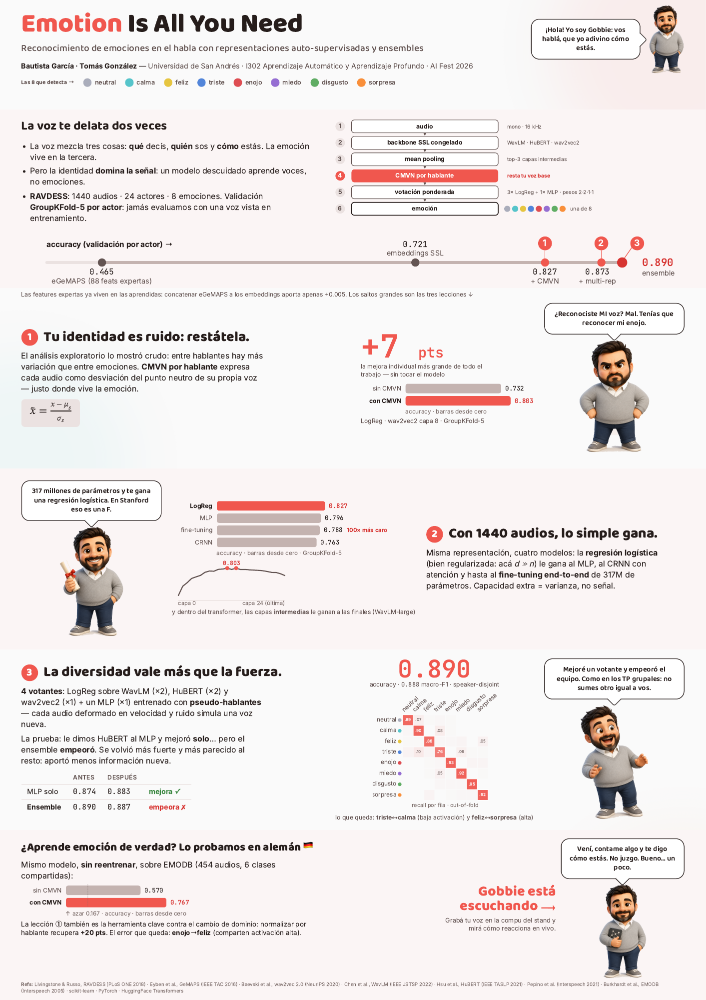
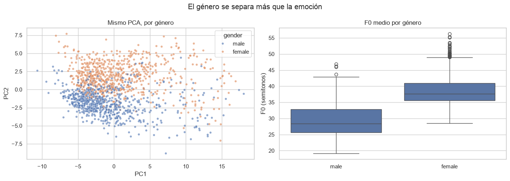
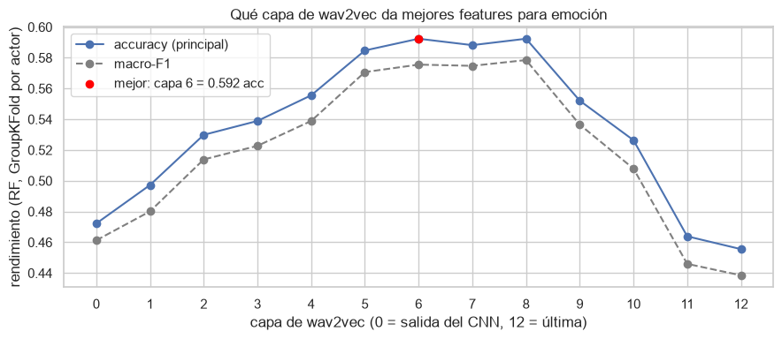
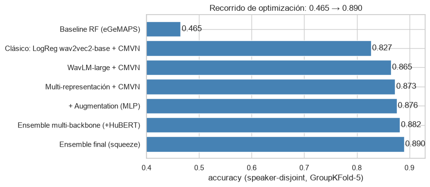
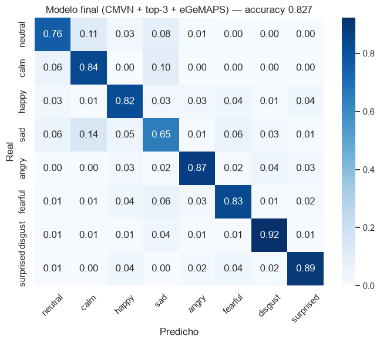

# Emotion Is All You Need
### Reconocimiento de emociones en la voz

¿Se puede saber cómo se siente alguien solo por su voz, sin que el modelo termine aprendiendo a reconocer a la persona? Esa pregunta guió nuestro proyecto final de Machine Learning, que presentamos en AI Fest 2026.

**Bautista García y Tomás González** · Aprendizaje Automático y Aprendizaje Profundo, UdeSA · 2026

[Informe](informe.pdf) · [Póster](docs/Garcia_Gonzalez_Poster_PF.pdf) · [Notebook](notebooks/main.ipynb) · [Cómo reproducirlo](docs/reproduccion.md)

## 1. El problema: la voz delata a la persona antes que a la emoción

Trabajamos con RAVDESS: 1.440 grabaciones de 24 actores que dicen las mismas frases con ocho emociones (neutral, calma, felicidad, tristeza, enojo, miedo, disgusto y sorpresa).

Al explorar los datos apareció el primer obstáculo. Las grabaciones se separan mucho más por quién habla que por la emoción: el género, por ejemplo, divide el espacio con claridad. Un modelo descuidado aprende a reconocer voces.

Por eso todas las evaluaciones son **por actor** (GroupKFold de cinco folds): las voces del test nunca aparecen en el entrenamiento.

## 2. Qué representación del audio usar

Comparamos 88 features acústicas clásicas (eGeMAPS) con los embeddings de tres modelos de voz preentrenados: wav2vec 2.0, HuBERT y WavLM. Los usamos congelados, sin reentrenarlos.

Un hallazgo que no esperábamos: las capas intermedias de estos modelos capturan la emoción mejor que la última.

## 3. Restarle a cada voz su propio punto neutro

La mejora más grande no vino de un modelo más grande. Vino de normalizar cada audio respecto del promedio de su hablante (CMVN por hablante): así el modelo ve cuánto se aparta la voz de lo habitual en esa persona, que es justamente donde está la emoción.

Después combinamos varias representaciones en un ensemble de tres regresiones logísticas y un MLP, con votación ponderada. También probamos un CRNN con atención y fine-tuning completo; con 1.440 audios, los modelos simples generalizaron mejor.

Las confusiones que quedan tienen sentido: tristeza con calma (las dos son de baja activación) y felicidad con sorpresa.

## 4. ¿Aprende emoción o aprende RAVDESS?

Para comprobarlo, probamos el modelo sin reentrenar sobre EMODB, un corpus en alemán con 454 audios y seis emociones compartidas. La normalización por hablante resultó clave también para este cambio de idioma.

| Evaluación | Accuracy | Macro F1 |
| --- | ---: | ---: |
| Ensemble · RAVDESS, validación por actor | 0,890 | 0,888 |
| EMODB · sin CMVN | 0,570 | 0,578 |
| EMODB · con CMVN | 0,767 | 0,787 |

Las cifras de EMODB no son directamente comparables con las de RAVDESS: cambian el idioma, el corpus y las clases. CMVN necesita varias grabaciones de cada hablante.

## Explorar o ejecutar

El notebook conserva las salidas de todos los experimentos, así que se puede recorrer sin entrenar nada. Para reproducirlo hacen falta Python 3.11 y los corpus; los pasos están en la [guía de reproducción](docs/reproduccion.md).

~~~sh
python -m src.predict ruta/al/audio.wav
~~~

La predicción necesita el modelo **data/processed/final_model.pkl**, que se genera desde el notebook. El repositorio no incluye los corpus, el modelo entrenado ni la interfaz en vivo del póster.

**Herramientas:** Python, PyTorch, Transformers, scikit-learn, OpenSMILE, NumPy y pandas.

[Detalle técnico de experimentos y archivos](DOCUMENTACION.md)
